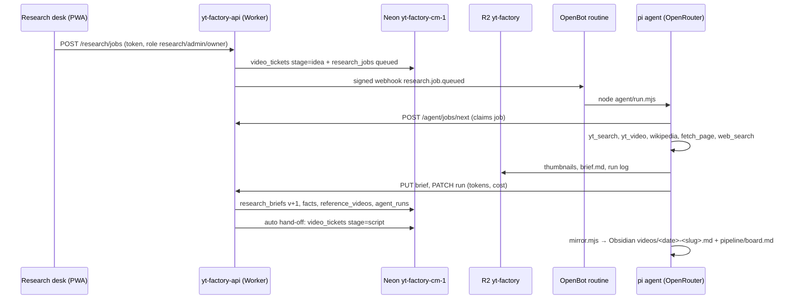

# YT Factory · Research desk

Stage 1 (Idea → Script) of the faceless YouTube factory: a PWA for the Research role, a pi research agent, and the data model in Neon.

| Piece | Path | Runs on |
|---|---|---|
| PWA (Expo web, Hallmark Almanac theme) | `app/` | GitHub Pages: https://thl007.github.io/yt-factory-research/ |
| API (Cloudflare Worker, Neon over HTTP, R2) | `api/` | https://yt-factory-api.thl007.workers.dev |
| Research agent (pi + OpenRouter) | `agent/` | this server, woken by the OpenBot routine "YT Factory: research pipeline" |
| Migrations, token minting | `db/` | Neon project `yt-factory-cm-1` |

Ops docs and the data model: Obsidian `yt-factory/pipeline/research-desk.md`.

## Flow



## Access tokens

`ytf_` + 48 hex characters. One token = one user + one role (`access_tokens`), stored only as a sha256 hash. Owners and admins mint and revoke them in the app (Tokens). Bootstrap/recovery from the server: `DATABASE_URL=… node db/mint-token.mjs <username> <role> [label] > file`.

| Role | Can |
|---|---|
| owner | everything, mint owner tokens, set the webhook secret |
| admin | everything except owner tokens and the webhook secret |
| research | create jobs, write/edit briefs, run the agent, hand off |
| content, production, publish | read jobs and briefs |

## Agent

`agent/run.mjs` drains the queue (max 5 per run). Model `anthropic/claude-haiku-5.5` via OpenRouter (`YTF_MODEL`), thinking low, tools only: `yt_search` (yt-dlp search), `yt_video` (oEmbed, optional YouTube Data API key, thumbnail image), `wikipedia`, `fetch_page` (public URLs only, `find` for long pages), `web_search` (OpenRouter web plugin, max 4 per job, about $0.02 each), `submit_brief`. No shell or file tools. The SOP `sops/00-research-brief.md` (status: blocked) is read at run time and is the agent's instructions.

Auto hand-off to Script needs: an angle, 5 facts with http(s) sources, 3 of them read at the source, and 3 competitor videos. Otherwise the job goes to review.

Limits: YouTube blocks video pages from the server (no transcripts; views come from search results). Add `YOUTUBE_API_KEY_FILE` in `agent/.env` for Data API stats.

`agent/.env` (not committed): `YTF_API`, `YTF_AGENT_TOKEN_FILE`, `OPENROUTER_API_KEY_FILE`, optional `YTF_MODEL`, `YTF_MAX_WEB_SEARCHES`, `YOUTUBE_API_KEY_FILE`.

## Develop

```sh
cd app && npm ci && npm run web          # PWA dev server
cd api && npx wrangler dev               # needs api/.dev.vars with DATABASE_URL
cd agent && npm ci && python3 -m venv .venv && .venv/bin/pip install yt-dlp
```

Deploy the PWA: `cd app && npm run deploy` (gh-pages). The Worker was deployed through the Cloudflare API (bindings: `BUCKET` → R2 `yt-factory`; vars `ALLOWED_ORIGINS`, `WEBHOOK_URL`, `BOOTSTRAP_HASH`); its Neon URL and webhook secret live in R2 `config/secrets.json`.
